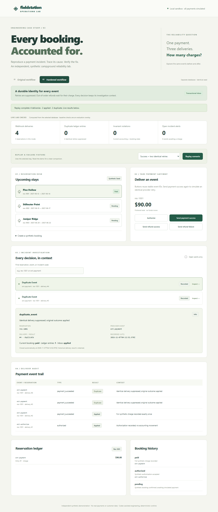

# Campground Booking Incident Reliability Lab

A reservation desk receives a simulated payment success three times. The original workflow books three accounting entries. The hardened workflow records one charge, retains every delivery, and gives support a correlated incident trail.

This is an **independent, synthetic, portfolio-company-inspired demonstration**. It is not a Beacon production change or a claim about a real incident. All amounts are fictional CAD cents. There are no payment-provider calls, credentials, customer data, or runtime AI dependencies.



## Verified outcome

Seven replay scenarios, 15 deliveries per version, fresh seeded SQLite databases, 31 legacy accounting assertions per version:

| Measure | Original | Hardened |
|---|---:|---:|
| Duplicate-identity ledger entries | 3 | 0 |
| Final-state invariant violations | 7 | 0 |
| Failed scenario assertions | 15 / 31 | 0 / 31 |
| Failed scenarios | 6 / 7 | 0 / 7 |

The duplicate-only scenario contributes two excess charge rows; conflicting reuse of an event ID contributes the third duplicate-identity row. [Methodology and limitations](docs/03-results.md), [raw replay evidence](evidence/comparison.json), [actual check outputs](evidence/verification.json).

The follow-up adds **38 separate protocol checks**: baseline fails 17/38; improved passes 38/38. These check HTTP status/outcome per delivery and incident linkage/severity; they are not included in the legacy 31 denominator. [Current evidence and red/green regressions](evidence/br-002/README.md) preserve the earlier results unchanged.

Current backend: **46 passed, 6 expected baseline failures**. Browser smoke: **3 passed**. Typecheck and build passed. The [independent review](docs/06-independent-review.md) fixed an inconsistent dashboard snapshot during a concurrent payment. These results do not measure human debugging speed or production reliability.

## Quickstart — Ubuntu / WSL

Run from this repository. Use Python 3.12+ with `venv` and Node 22.12+ (or Node 24). The recorded execution used Python 3.13.14 / Node 24.22.0 on Windows; Ubuntu/WSL commands below are provided for handoff and were not executed on an Ubuntu host.

```bash
# Ubuntu prerequisites if Python/venv are not installed
sudo apt-get update
sudo apt-get install -y python3 python3-venv
# Install an appropriate Node version using your team's normal tooling first.

python3 -m venv .venv
source .venv/bin/activate
python -m pip install -r requirements.txt -c requirements-lock.txt
npm ci
bash scripts/reset-demo.sh
```

Start the backend in terminal 1:

```bash
source .venv/bin/activate
python -m uvicorn backend.main:app --host 127.0.0.1 --port 8003
```

Start the frontend in terminal 2:

```bash
npm run dev
```

Open **http://127.0.0.1:5175**. API documentation: **http://127.0.0.1:8003/docs**. Vite proxies `/api` to port `8003`; the frontend binds strictly to `5175`. No Docker, external account, or environment file is needed. Assets use local system fonts.

## Demo

1. Begin with a fresh reset. Leave `res-1001` selected in **Original workflow**.
2. Click **Replay scenario** with **Success + two identical retries** selected. Four deliveries include one authorization and three identical successes. The ledger has three charges and two duplicate rows.
3. Inspect the original manual-log guidance. The live invariant cards are a **lab evaluation overlay**, not an incident feature claimed for the original product.
4. Switch to **Hardened workflow**, replay the same fixture, and inspect a **duplicate event** record. Four deliveries produce one charge; the other two successes are suppressed. Event, reservation, delivery, inbox outcome, and current ledger context are connected.
5. Click **Send refund failure** after the charge. An open alert appears; the booking stays paid. See [the demo script](docs/demo-script.md) for the early-refund and guest-booking paths.

To compare a different fixture independently, stop both servers, reset, and restart. Replays intentionally operate on the selected stay's **existing state**; they do not silently clear data. On `res-1001`, UI replay sends the checked-in event payloads unchanged. Other stays substitute their ID and fictional total.

## Tests and reproducible evidence

Stop any running demo servers before UI tests; Playwright requires ports `5175` and `8003` and refuses to reuse an existing server. Backend tests and CLI replay need no running server.

```bash
source .venv/bin/activate
python -m pytest -q
npm run typecheck
npm run build
python -m backend.replay --modes baseline improved --output evidence/comparison.json

# One-time browser setup on Ubuntu/WSL; may require sudo for OS libraries
npx playwright install --with-deps chromium
npm run test:ui

# All checks, saved outputs, replay results and screenshots
bash scripts/verify.sh --ui
# Without a browser: runs every check except UI smoke
bash scripts/verify.sh
```

`scripts/verify.py` captures actual exit codes and outputs in `evidence/verification.json` and `evidence/*.txt`, and returns nonzero if any check fails. Its npm audit check requires registry access. Runtime, tests other than browser installation/audit, and replay work without external services after dependencies are installed. The replay command returns nonzero if improved legacy or protocol assertions fail; baseline shortcomings are reported as comparison data. `--output` is required: a bare replay command exits with usage code 2 before processing, protecting historical diagnosis evidence. For a new report without replacing recorded evidence, use `--output data/reports/comparison.json`.

If installed Chrome is available instead of managed Chromium:

```bash
PLAYWRIGHT_CHANNEL=chrome npm run test:ui
PLAYWRIGHT_CHANNEL=chrome bash scripts/verify.sh --ui
```

Recorded browser evidence uses installed Chrome: managed Chromium download failed with insufficient disk space. The UI suite starts its own explicitly isolated `data/ui-smoke` databases, leaves the ordinary demo databases alone, and uses distinct bookings across its three flows.

## Reset, persistence, and logs

```bash
# Stop both servers first. Replaces only the two synthetic mode databases/logs.
source .venv/bin/activate
bash scripts/reset-demo.sh

# An explicit alternate demo directory, if desired
BOOKING_DATA_DIR=data/alternate python -m backend.seed
BOOKING_DATA_DIR=data/alternate python -m uvicorn backend.main:app --host 127.0.0.1 --port 8003

# Original manual inspection, after a replay
grep 'evt-payment' data/logs/baseline.jsonl
```

Seed IDs, dates, prices, and states are fixed. Runtime audit timestamps and newly created booking IDs vary. Each mode starts with three campsites and three pending reservations. SQLite files and logs persist under ignored `data/`. Reset clears synthetic reservations, accounting, and audit history in that demo directory; it leaves checked-in evidence unchanged.

The authoritative audit is SQLite `deliveries` / `incidents`, committed with business effects. `data/logs/{mode}.jsonl` is a best-effort local JSON mirror. A file-log failure is reported to stderr without retrying an already committed payment. [Sample logs](evidence/logs/improved.jsonl) contain synthetic IDs and error codes, not personal or card data.

## Small architecture and API

React + TypeScript + Vite call FastAPI. Python's SQLite driver provides explicit transactions and unique constraints. There are two independent local databases, one fake provider, and one process. No model calls participate in booking or accounting decisions.

| Route | Behavior |
|---|---|
| `GET /api/health` | Local health and simulated-payment marker |
| `GET /api/fixtures` | Checked-in deterministic replay cases |
| `GET /api/{baseline\|improved}/dashboard` | Live reservations, accounting, history, deliveries, metrics, incident context |
| `POST /api/{baseline\|improved}/bookings` | Date/price/overlap validation and booking-key idempotency |
| `POST /api/{baseline\|improved}/webhooks` | Fake provider event ingestion; no funds move |

Example webhook:

```bash
curl -sS -X POST http://127.0.0.1:8003/api/improved/webhooks \
  -H 'Content-Type: application/json' \
  -d '{"event_id":"example-payment","reservation_id":"res-1001","type":"payment_succeeded","amount_cents":9000}'
```

Supported types: `authorized`, `payment_succeeded`, `refund_succeeded`, `refund_failed`. Only full amounts are supported. Improved business rejections return `409` with a retained incident; valid retries return `200` without additional effects. Malformed requests return `422`; a busy webhook database returns `503` so the same event can be retried. An identical retry of an already rejected event remains `409`.

SQLite BUSY/LOCKED (including extended codes) produces retryable `503`. Other storage errors return a generic `500` directing investigation before retry; client messages do not reveal internal paths or exception text. The application logs the actual exception to server stderr with mode, event ID and reservation ID, even when the database cannot persist an incident. Fault-injection tests are simulated failures, not evidence of a host disk incident.

## Code and case-study map

- [Original handler](backend/baseline.py), [hardened state machine](backend/improved.py), [schema/transactions](backend/db.py), [API](backend/main.py).
- [Regression tests](backend/tests/test_reliability.py), [known baseline failures](backend/tests/test_diagnosis.py), [replay fixtures](fixtures/replays.json), [replay harness](backend/replay.py), [browser flows](e2e/smoke.spec.ts).
- Gates: [baseline](docs/01-baseline.md), [diagnosis](docs/02-diagnosis.md), [results](docs/03-results.md), [AI-assisted process](docs/04-ai-engineering-process.md), [tradeoffs](docs/05-tradeoffs.md).
- [Operational runbook](docs/runbook.md), [interview demo](docs/demo-script.md), [portfolio case study](portfolio/case-study.md), [evidence index](evidence/README.md).

Git gates: `f3883f3` / `baseline-demo` → `11e96dc` diagnosis → `ca3057d` improvement. The final tree retains the tagged baseline handler unchanged; [provenance](evidence/provenance.json) verifies that identity.

## Troubleshooting and limits

| Symptom | Action |
|---|---|
| API load error / proxy connection refused | Start uvicorn from the repo root on `8003`; check `/api/health`. |
| `Address already in use` or Playwright refuses startup | Stop the existing task servers on `8003` / `5175`; do not change this demo's assigned ports. |
| Browser executable / Linux shared library missing | Run `npx playwright install --with-deps chromium`, or use an installed supported Chrome channel. |
| Disk full during browser installation | Free disk space using your normal host tooling, or use installed Chrome. No host cleanup is performed by this project. |
| Unexpected extra rows during a manual replay | Stop, reset, restart. UI replay does not erase earlier events. CLI replay always uses fresh databases. |
| SQLite file locked on reset | Stop server/test processes first. Reset is an offline demo operation. |
| Frontend PowerShell npm script blocked | On Windows use `npm.cmd`; Ubuntu/WSL uses `npm`. Windows virtualenv executable is `.venv/Scripts/python.exe`. |
| Starlette/AnyIO deprecation warning in pytest | Known upstream warning in the pinned environment; tests still pass. Do not suppress real test failures. |
| npm audit network failure | Restore registry access and rerun the verification script; a missing audit is not a passing audit. |

This localhost-only lab has no authentication, webhook signatures, partial payments/refunds, external reconciliation, alert delivery service, or production migration. One reservation has at most one full charge and one full refund. Error alerts remain available for human review; only deferred-refund prerequisite alerts close automatically. Review the [tradeoffs](docs/05-tradeoffs.md) before extending the model.
