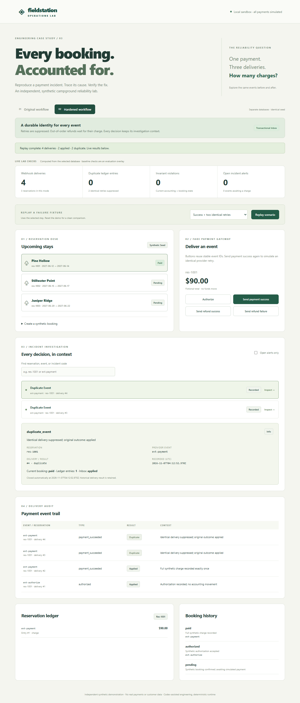

# AI-Assisted Production Incident Investigation: Hardening a Booking Workflow Against Duplicate Payment Events

**Independent, synthetic, portfolio-company-inspired demonstration.** No Beacon systems, real customers, funds, or payment providers were involved. “Production incident investigation” describes the engineering practice illustrated, not a claim that this change was deployed to production.

## Existing operation

A campground reservation desk accepts a stay, calculates its fictional total, and records a confirmation. A local fake payment gateway emits authorization, payment-success, and refund events. An admin can inspect reservation status, ledger entries, deliveries, and history.

The working baseline already validates bookings, prevents overlapping stays, supports booking idempotency keys, and wraps each webhook delivery in a database transaction. Its narrower reliability weakness is realistic: it trusts every delivery as a new business event and updates status in arrival order. A provider retry therefore creates another accounting entry even though the reservation still looks paid.

The original workflow was committed and tagged before improvement: `f3883f3`, `baseline-demo`. It remains available unchanged for comparison.

## Bottleneck and diagnosis

Support would have to find a provider event in logs, locate its reservation, compare accounting, and reconcile state/history manually. Engineers also need to understand whether the event is duplicated, stale, invalid, or waiting for a prerequisite before making a safe change.

Seven fixed synthetic fixtures reproduced identical success retries, late authorization, refund-before-charge, refund failure, incorrect amounts, conflicting event identity, and an ordinary payment control. The diagnosis found three duplicate-identity ledger rows, seven final invariant violations, and 15 failed assertions out of 31.

## Codex-supported intervention

Codex inspected the handler, SQLite schema, replay traces, structured logs, and failed tests. The design review selected a durable provider-event inbox, payload identity checking, unique ledger constraints, and transactional state transitions. A valid early refund is deferred until its charge arrives; stale authorization cannot regress a paid booking. Invalid transitions retain explicit error context.

The admin now correlates event IDs, delivery IDs, reservation state, and ledger context. A fixture replay control makes the before/after behavior visible. Regression tests cover concurrency, restart persistence, all six authorization/payment/refund orderings with retries, and a storage failure during reconciliation.

Codex also investigated genuine tooling failures, including SQLite connection cleanup and a browser-test reset/serve path mismatch. These were fixed and rerun. This was autonomous AI-assisted engineering with test/self-review evidence; no independent human review or elapsed human engineering-time study occurred.

## Improved operation and measured outcome

Each fixture runs through both FastAPI implementations against a fresh, identical SQLite seed. There are seven scenarios and 15 deliveries per mode.

| Outcome | Original | Hardened |
|---|---:|---:|
| Duplicate-identity ledger entries | 3 | 0 |
| Final invariant violations | 7 | 0 |
| Failed assertions | 15 / 31 | 0 / 31 |
| Failed scenarios | 6 / 7 | 0 / 7 |

In the required retry demonstration, one success plus two identical retries produces three baseline charge rows versus one hardened charge. Every delivery remains inspectable. The aggregate third duplicate-identity row comes from a separate conflicting-payload scenario.

The formal verification run recorded **33 backend passes**, six exact expected baseline failures, **three passing browser flows**, and passing TypeScript/build checks. The browser also verified mobile booking confirmation, safe resubmission, and overlap rejection. [Raw results](../evidence/comparison.json), [execution metadata](../evidence/verification.json), and [methodology](../docs/03-results.md) support these claims.

Ordinary payment accounting did not need improvement. Failed-refund accounting was already preserved; the added value there is an alert with diagnostic context. Detection latency, human debugging time, engineering hours saved, and production throughput were not measured. A four-action manual investigation recipe becomes a two-action correlated-view recipe, but that authored step count is not a human productivity result.

## What the team inherits

The runtime is ordinary deterministic software: React/TypeScript/Vite, FastAPI/Python, SQLite, constraints, explicit rules, and structured audit records. AI assisted analysis, implementation, tests, and handoff; it does not handle funds or decide payment state. Humans still own business semantics, ambiguous incidents, real reconciliation, review, and rollout.

The repository includes [quickstart/reset/test commands](../README.md), an [operational runbook](../docs/runbook.md), a [demo script](../docs/demo-script.md), [tradeoffs](../docs/05-tradeoffs.md), preserved Git gates, and [browser evidence](../evidence/README.md). It is a maintainable narrow slice, not a production payment integration: one synthetic provider, one full charge/refund per booking, no authentication or real settlement reconciliation.

